# Customer Service Queue Management System

## Project Description

Service counters such as help desks, banks, and government offices need an orderly way to handle customers who arrive at different times with different concerns. Without a system, customers can be skipped, served out of turn, or forgotten, and staff have no quick way to look up a customer's record.

This console-based Java application addresses that problem. Staff can register customers along with their concerns and estimated service time, place them in a waiting line, and serve them in the order they arrived (First-In, First-Out). The system also lets staff sort and search customer records and, when needed, reorder the waiting line so that shorter requests are handled first.

The program is written procedurally, as the project requires: it uses only the `main` method, static methods, `ArrayList`s, and a Java `Queue`. It does not use custom classes or any other OOP technique.

## Objectives

- Register and store customer records using Java `ArrayList`s.
- Manage the waiting line using a queue that follows the FIFO principle.
- Implement sorting algorithms manually, without Java's built-in sort methods.
- Provide search functionality to locate customer records.
- Use loops, conditional statements, methods, and input validation to build a stable, menu-driven console application.
- Handle invalid input without crashing and show clear messages for empty lists, empty queues, and missing records.

## Use Cases and Features

The program is menu-driven. The main menu options are:

| Option | Feature | Description |
|:------:|---------|-------------|
| 1 | Register a customer | Records the customer's name, concern, and estimated service duration (1–180 minutes). The system assigns a unique ID starting at 1001. |
| 2 | Add customer to queue | Enqueues a registered customer by ID. Customers who are already waiting or already served cannot be added again. |
| 3 | Serve next customer | Dequeues the customer at the front of the line and marks them as Served. |
| 4 | Peek at next customer | Shows who is next without removing them from the queue. |
| 5 | Display waiting queue | Lists everyone waiting from front to rear, with the total number of customers and the estimated total wait time. |
| 6 | Check if queue is empty | Reports whether anyone is waiting. |
| 7 | Display all records | Shows every stored customer record in a table, including status. |
| 8 | Sort customer records | Sorts records by name (A–Z or Z–A), duration (shortest or longest first), or ID. Records are displayed before and after sorting. |
| 9 | Sort waiting queue by duration | Reorders the waiting queue so the shortest requests are served first. |
| 10 | Search customer | Finds records by exact ID or by a full or partial name. |
| 11 | Remove customer record | Deletes a record from all lists, and from the queue if the customer is waiting. |
| 0 | Exit | Ends the program. |

**Customer status flow:** `Registered` → `Waiting` (enqueued) → `Served` (dequeued)

**Input validation and messages:**

- Menu choices, IDs, and durations must be whole numbers within the allowed range. Letters and out-of-range numbers are rejected and the user is asked again.
- Names and concerns cannot be left blank.
- Clear messages are shown when there are no records, the queue is empty, an ID is not found, or an operation cannot be completed.

## Data Structure Explanation

### ArrayLists (record storage)

Customer records are stored in five parallel `ArrayList`s. The element at index `i` in every list belongs to the same customer:

| ArrayList | Type | Stores |
|-----------|------|--------|
| `ids` | `ArrayList<Integer>` | Unique customer ID |
| `names` | `ArrayList<String>` | Customer name |
| `concerns` | `ArrayList<String>` | Concern or service needed |
| `durations` | `ArrayList<Integer>` | Estimated service time in minutes |
| `statuses` | `ArrayList<String>` | `Registered`, `Waiting`, or `Served` |

Because the lists must stay aligned, every operation that changes records updates all five together:

- **Add:** one value is appended to each list.
- **Remove:** the same index is removed from each list.
- **Sort:** the `swapRecords()` method swaps the same two positions in all five lists at once.

A linear search (`findIndexById`) loops through `ids` to find the index of a customer, and that index is then used to read the other lists.

### Queue (service line)

The waiting line is a `Queue<Integer>` implemented with `LinkedList`:

```java
static Queue<Integer> waitingQueue = new LinkedList<>();
```

| Operation | Method used | Where it is used |
|-----------|-------------|------------------|
| Enqueue | `add()` | Option 2: adds the customer's ID to the rear of the line |
| Dequeue | `poll()` | Option 3: removes and serves the customer at the front |
| Peek | `peek()` | Option 4: views the front customer without removing them |
| Display | enhanced `for` loop | Option 5: lists the line without changing it |
| Empty check | `isEmpty()` | Options 3, 4, 5, and 6 |

The queue stores **customer IDs instead of list indexes**. Sorting moves records to new positions in the ArrayLists, which would make stored indexes point to the wrong customers. IDs never change, so the queue stays correct no matter how the records are sorted.

The queue is part of the main workflow: a customer must be registered, then enqueued, and then dequeued to be served. The queue is also used by sorting, since option 9 reorders the waiting line.

## Sorting Algorithm Explanation

All sorting algorithms are written by hand. No built-in sorting methods such as `Collections.sort()` or `Arrays.sort()` are used.

### 1. Insertion Sort: sorting by customer name

- **Purpose:** Arrange customer records alphabetically (A–Z) or in reverse (Z–A).
- **How it works:** Starting from the second record, each record is moved left past any records that should come after it, until it sits in the correct place. Names are compared with `compareToIgnoreCase()`, so capitalization does not affect the order.
- **Why it suits this use case:** A customer list is usually small and often partly in order, which is where insertion sort performs well. It is also stable, so customers with the same name keep their original relative order.
- **Where it is used:** Menu option 8, choices 1 and 2 (`insertionSortByName`).

### 2. Selection Sort: sorting by service duration

- **Purpose:** Arrange customer records by estimated service time, shortest first or longest first.
- **How it works:** For each position, the method scans the rest of the list to find the record with the smallest (or largest) duration and swaps it into place.
- **Why it suits this use case:** Selection sort performs at most one swap per position. Moving a record means swapping across five ArrayLists, so fewer swaps keeps the work low. Sorting by duration helps staff see which requests are quick or long.
- **Where it is used:** Menu option 8, choices 3 and 4 (`selectionSortByDuration`), and menu option 9, which applies the same selection sort to the waiting queue.

### Additional sorting features

- **Bubble Sort (`bubbleSortById`):** Menu option 8, choice 5, restores the original registration order by sorting on ID.
- **Queue sort by duration:** Menu option 9 copies the queue into a temporary list, sorts it by duration with selection sort, clears the queue, and enqueues the IDs back in the new order. This gives a "shortest request first" line. It intentionally overrides pure first-come-first-served order, so use it only when that is the desired policy.

## How to Run the Program

### Requirements

- Java Development Kit (JDK) 8 or higher
- A terminal or command prompt

Check that Java is installed:

```bash
javac -version
java -version
```

### Steps

1. Place `CustomerServiceQueue.java` in a folder and open a terminal in that folder.

2. Compile the program:

   ```bash
   javac CustomerServiceQueue.java
   ```

3. Run the program:

   ```bash
   java CustomerServiceQueue
   ```

4. Enter a menu number and press **Enter**. Choose `0` to exit.

### Project structure

```
CustomerServiceQueue/
├── CustomerServiceQueue.java
├── README.md
└── screenshots/
    ├── 01-main-menu.png
    ├── 02-register-and-display.png
    ├── 03-queue-operations.png
    ├── 04-fifo-behavior.png
    ├── 05-insertion-sort.png
    ├── 06-selection-sort.png
    └── 07-input-validation.png
```

## Screenshots of the System

> All screenshots were taken from the running application.

### 1. Main menu

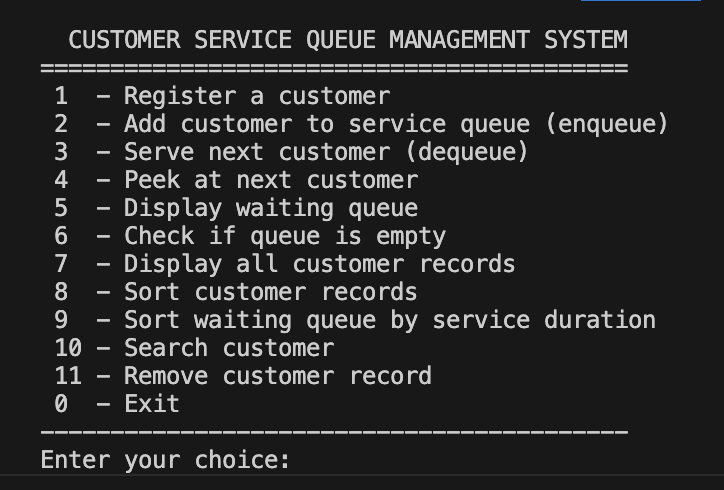

*The main menu showing all available options.*

### 2. Adding records and displaying stored records

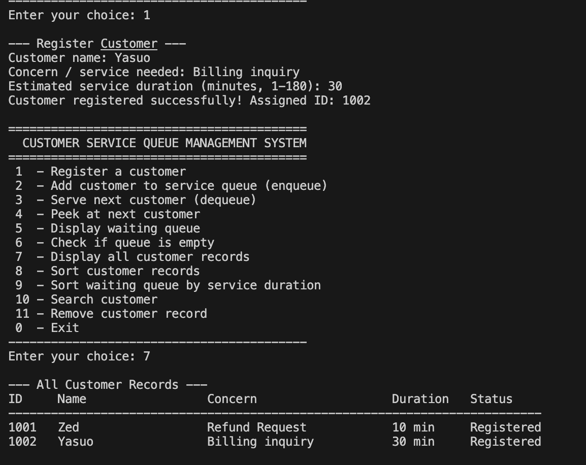

*Several customers are registered (option 1), then all stored records are shown with option 7. New records start with the status "Registered".*

### 3. Queue operations: enqueue, peek, dequeue, and display

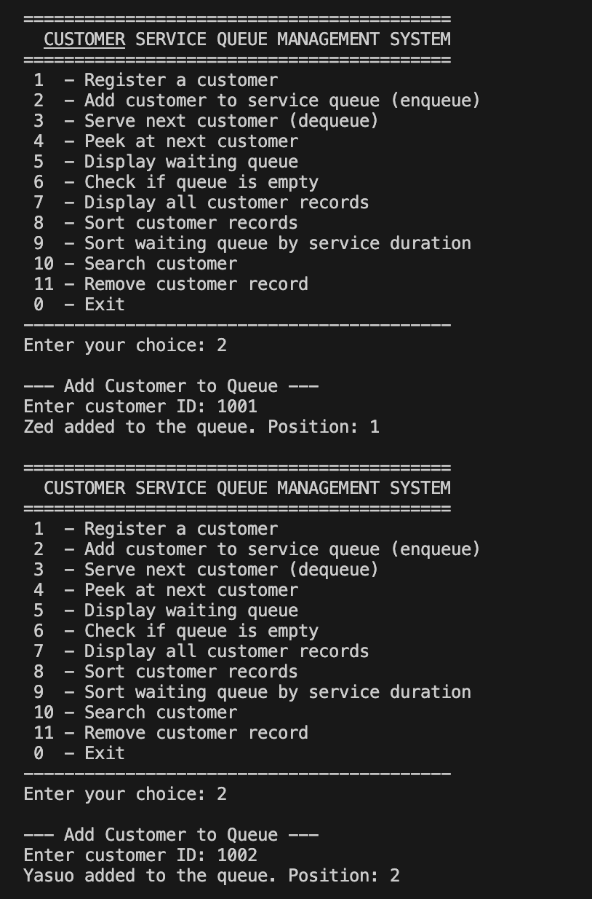

*Customers are added to the queue using option 2.*

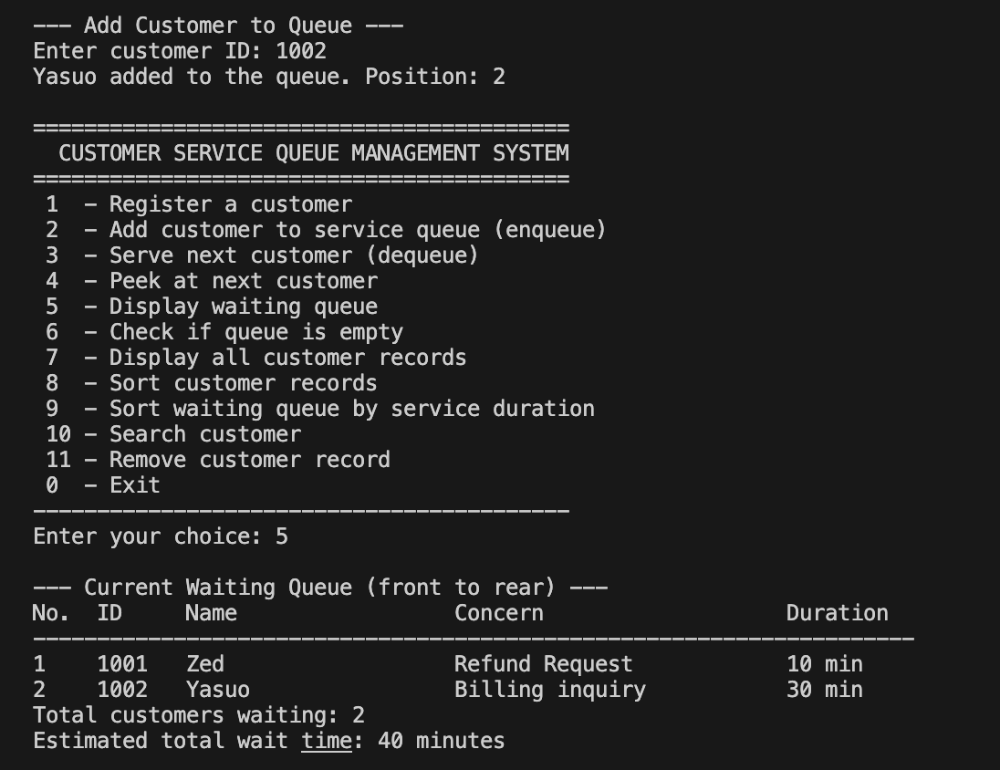

*The waiting queue is displayed using option 5.*

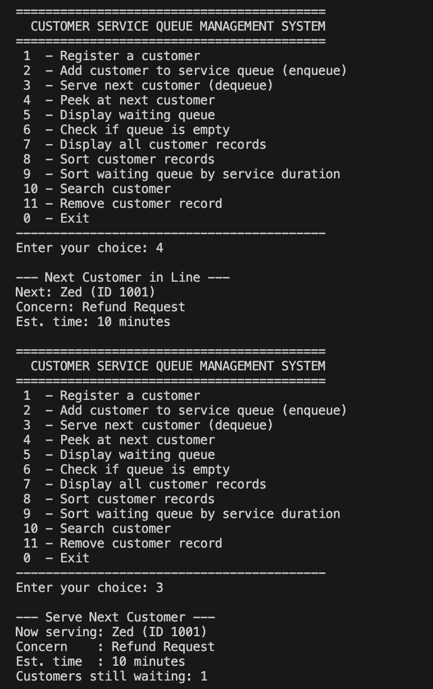

*The next customer is viewed without being removed using option 4.*

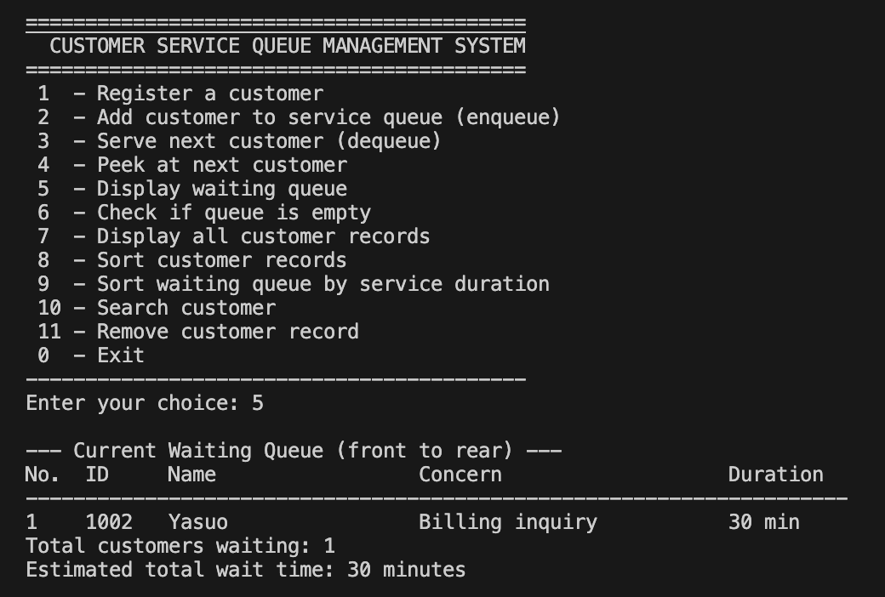

*Customers are added to the queue (option 2), the queue is displayed (option 5), the next customer is peeked (option 4), and a customer is served (option 3). The queue is displayed again afterward to show the change.*

### 4. FIFO behavior

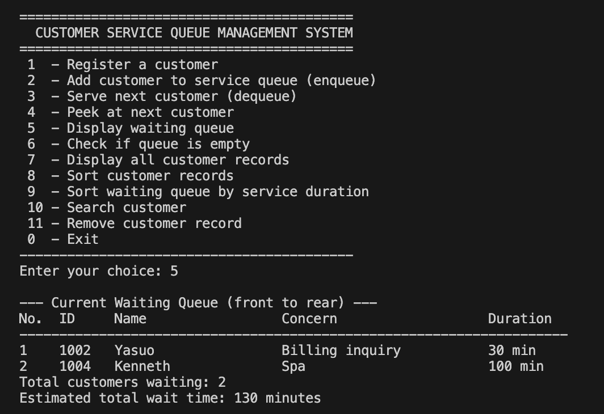
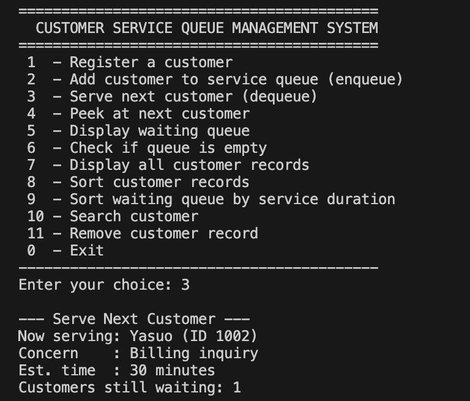
*Customers are enqueued in a known order and then served one by one. The first customer added is the first one served, followed by the second, and so on.*

### 5. First sorting algorithm: Insertion Sort (by name)

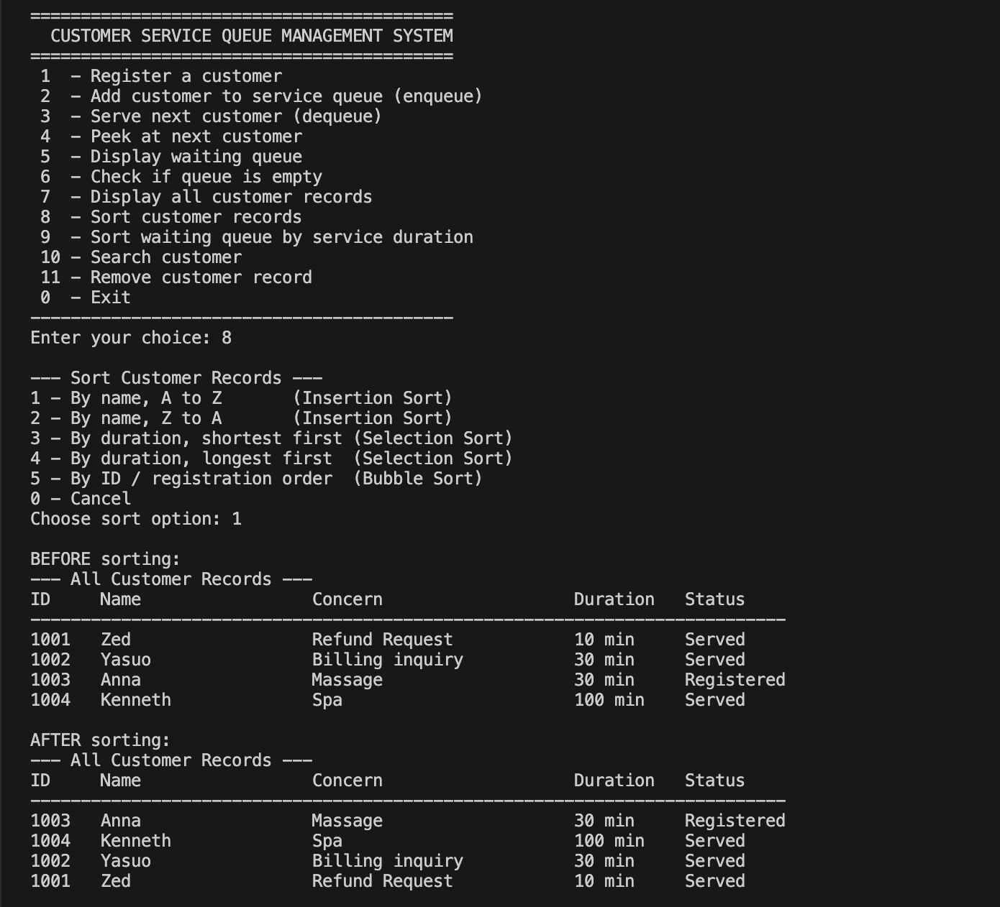

*Option 8, choice 1. The "BEFORE sorting" table shows the records in registration order, and the "AFTER sorting" table shows them in alphabetical order.*

### 6. Second sorting algorithm: Selection Sort (by duration)

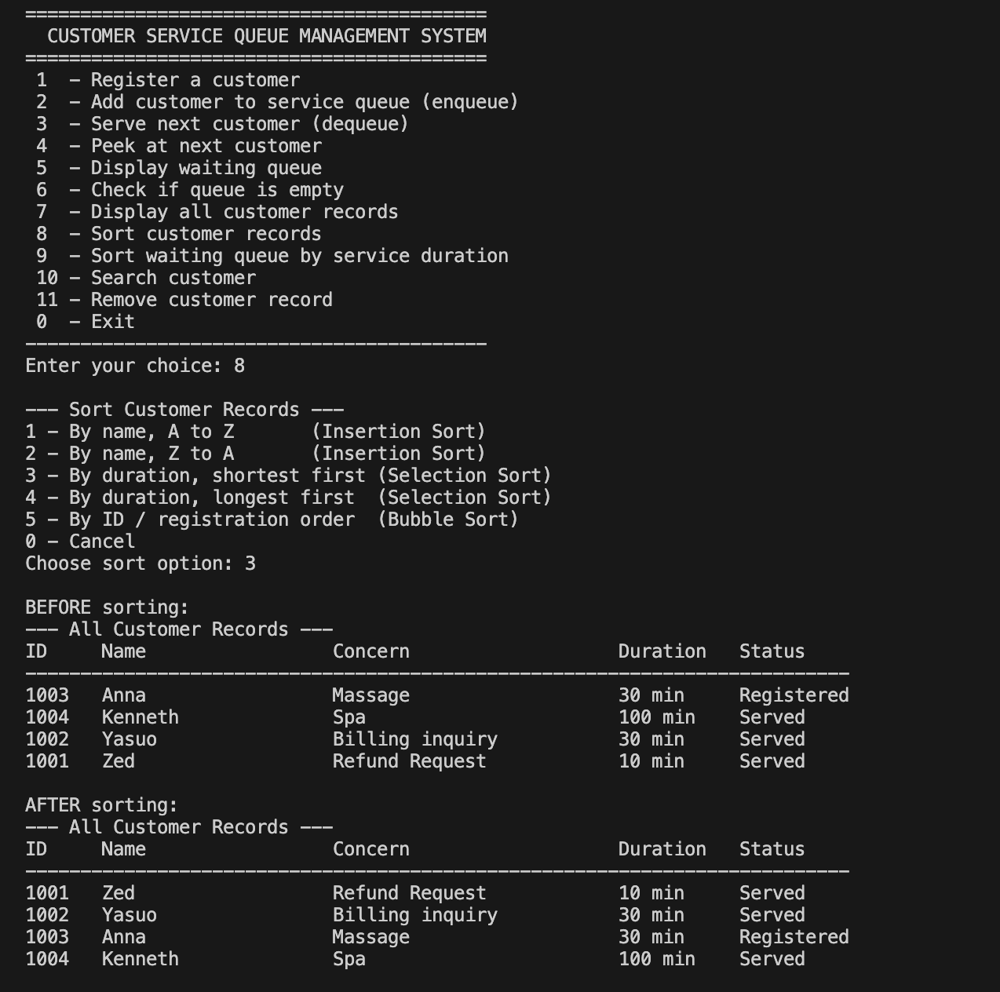

*Option 8, choice 3. The "BEFORE sorting" table shows the original order, and the "AFTER sorting" table shows the records from shortest to longest service duration.*

### 7. Input validation and error messages

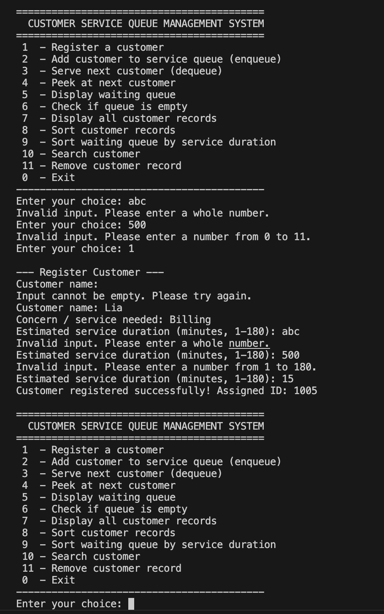

*Invalid inputs such as letters instead of numbers, out-of-range menu choices, blank text, an unknown customer ID, and operations on an empty queue. Each one shows a clear message and the program keeps running.*